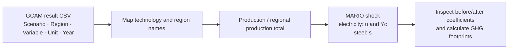
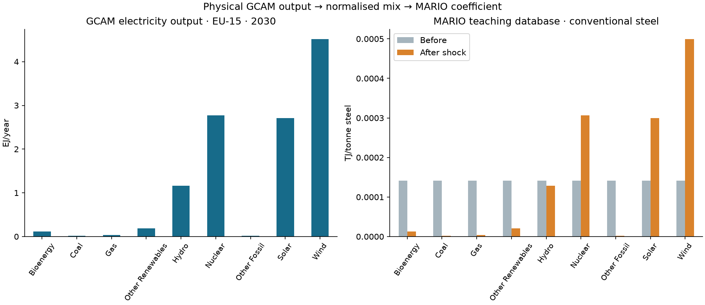

# GCAM–MARIO: from scenario outputs to input–output shocks

**Read a GCAM result file, see how MARIO interprets each value, and inspect the resulting coefficient changes.**

GCAM supplies regional production by technology, scenario and year. This repository
turns those physical quantities into electricity and steel mixes and applies them
to a MARIO supply–use model. The example runs from exported results: no GCAM
installation is required.



## One value, all the way to a MARIO coefficient

The bundled [`electricity.csv`](examples/gcam-output/electricity.csv) is an
unnormalised extract of the published GCAM export. For **NDC_LTT_CBAM, EU-15, 2030**:

| GCAM file says | The adapter interprets | MARIO receives |
|---|---|---|
| `Secondary Energy\|Electricity\|Wind`: **4.51167191 EJ/yr** | Map the variable to commodity `Wind`; divide by the sum of the nine electricity technologies, **11.5304167607 EJ/yr** | Wind share **0.391284374506** |

In the small teaching database, the conventional steel activity uses a total of
**0.001275 TJ/tonne** of electricity supplied by EU-15. The shock assigns:

```text
new Wind use coefficient = GCAM Wind share × original total electricity coefficient
                        = 0.391284374506 × 0.001275
                        = 0.000498887577495 TJ/tonne
```

The same calculation runs for each eligible consuming activity and for final
demand. The total is preserved in each column. There is no conversion of the
absolute GCAM electricity volume into MARIO demand: physical GCAM units cancel
when calculating the mix. [Follow the complete mechanism](docs/from-gcam-to-mario.md).



GCAM values from the published supplement; the MARIO coefficients in this figure
use fictional teaching inventories. The [notebook](notebooks/GCAM_to_MARIO.ipynb)
generates the figure and reads back the actual updated coefficients.

## Run the example

Use a dedicated Python 3.12 environment from this checkout:

```bash
python3.12 -m venv .venv
source .venv/bin/activate
python tools/install.py
gcam-mario demo --scenario NDC_LTT_CBAM --year 2030
```

The **GCAM inputs are real**. The small MARIO database uses **fictional inventories
and baseline demand** to make the mechanism quick to run and easy to inspect;
its footprints are illustrative. [Installation](docs/installation.md).

Open [`notebooks/GCAM_to_MARIO.ipynb`](notebooks/GCAM_to_MARIO.ipynb) for the same
sequence with raw rows, normalisation, coefficient edits and separate electricity,
steel and combined scenarios.

The output directory contains:

| File | Question it answers |
|---|---|
| `input_interpretation.csv` | Which source file, row, GCAM variable and physical value produced this share? |
| `mixes.csv` | Which shares were assigned to each MARIO region and technology? |
| `coefficients_before_after.csv` | What was the old coefficient, what total was preserved, and what is the actual new coefficient? |
| `footprints.csv` | How does the steel GHG footprint change, in tCO2eq/tonne steel? |
| `run.json` | Which inputs, concordances, switches, database and conservation checks were used? |

## Choose inputs and isolate a shock

```bash
# Interpret the files without loading an IO database
gcam-mario inspect --scenario NDC_LTT_CBAM --year 2030

# Apply only the electricity mix
gcam-mario demo --scenario NDC_LTT_CBAM --year 2050 --only electricity

# Read your own GCAM exports
gcam-mario demo --electricity-export /path/electricity.csv --steel-export /path/steel.csv
```

The input contract is explicit: `Model` (optional), `Scenario`, `Region`,
`Variable`, `Unit`, and year columns; a long `Year,Value` layout also works.
[Input files, sources and mappings](docs/input-contract.md) · [Python API](docs/api.md).

## Apply the same mechanism to extended EXIOBASE

```bash
gcam-mario prepare
gcam-mario run --scenario NDC_LTT_CBAM --year 2030 --offline
```

The first preparation downloads the six fixed source matrices from
[Zenodo 16779787, version 1.3.0](https://doi.org/10.5281/zenodo.16779787), verifies
their checksums, converts them to Parquet, aggregates EU countries to EU-12/EU-15
and saves a reusable bundle. The download is **1.78 GB**; an existing local source
can be supplied with `--source /path/to/parquets`.
[Preparation and provenance](docs/database-preparation.md).

This workflow updates the selected EU electricity and steel mixes. Global
background inventories, total demand and trade patterns retain their database
values. GCAM absolute steel consumption and import volumes are separate inputs
and are not applied by these mix shocks.

## Research and original scripts

Ghezzi et al. (2026), [*Linking Global Integrated Assessment and Hybrid Input–Output
Models To Support Steel Decarbonization Policies in Europe*](https://doi.org/10.1021/acs.est.5c15099).

The electricity extract comes from the article's public supplement. Regional
steel production comes from the study maintainer's `SteelProdTech` export; its
EU-12 + EU-15 totals match all **504** published scenario/year/technology values.
[Input provenance and data terms](examples/gcam-output/README.md).

The existing study scripts, inventories and processed GCAM workbooks remain in
the repository. The new executable example is an explanation of the coupling;
it does not claim to recreate the complete study or rerun GCAM.
[Original workflow and reproduction scope](docs/research-workflow.md) ·
[Executed verification](docs/verification.md).
